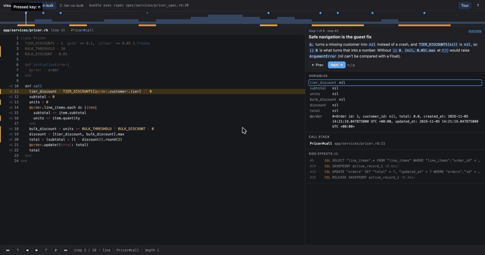

# visualdebug

**Execution traces you can scrub through, annotated by AI, for code review.**

`visualdebug` records how your code actually runs for a concrete example — every line, the local
variables at each step (with what changed highlighted), the call stack, and side effects like SQL —
and turns the recording into one self-contained HTML file you step through forwards and backwards.

It ships with a [Claude Code](https://claude.com/claude-code) skill: ask "help me review this PR" and
the agent picks examples that exercise the change, traces them, and writes a guided tour (with a
short quiz) over the trace. Then *you* do the stepping.



- **Ruby / Rails** (RSpec, Minitest, scripts), **Python** (pytest, scripts, Django-aware) and
  **Node / TypeScript** (node, Jest, Vitest, tsx).
- No changes to your Gemfile, requirements or package.json: probes are injected through
  `RUBYOPT`, `PYTHONPATH` and `NODE_OPTIONS`.
- Deterministic: the tool never calls an LLM, never touches the network, and the viewer works
  offline from `file://`. Secrets (`password`, `token`, `api_key`, ...) are redacted before anything
  is written.

## Install

```sh
# macOS / Linux
curl --proto '=https' --tlsv1.2 -LsSf https://github.com/louispt1/visualdebug/releases/latest/download/visualdebug-installer.sh | sh
# Homebrew
brew install louispt1/tap/visualdebug
# From source
cargo install visualdebug
```

Then, for Claude Code: `visualdebug install-skill` (all projects) or `visualdebug install-skill --project`
(commit `.claude/skills/visualdebug` to share it with your team).

## Use it with Claude Code

In a repository with a branch or PR checked out:

> help me review this PR

The skill reads the diff, runs `visualdebug doctor`, chooses 1–3 examples (existing tests first),
traces them focused on the changed lines, writes the tour and quiz, and opens the viewer with a short
orientation. Example output: [docs/examples/guest-bulk-discount-review.html](docs/examples/guest-bulk-discount-review.html)
(download and open it).

## Use it directly

```sh
visualdebug doctor                       # what's here, what would block a trace
visualdebug run --focus-diff main --start-at "Pricer#call" -- bundle exec rspec spec/services/pricer_spec.rb:42
visualdebug run --focus-diff main -- pytest tests/test_pricing.py::test_bulk_discount
visualdebug run --focus-diff main -- npx vitest run src/pricing.test.ts
visualdebug summarize pricer_spec-42     # compact, step-numbered text (what an agent reads)
visualdebug view pricer_spec-42          # bundle into .visualdebug/view-pricer_spec-42.html and open it
visualdebug annotate pricer_spec-42 notes.json   # add your own tour (schema/annotations.schema.json)
visualdebug compare main --start-at "Pricer#call" -- bundle exec rspec spec/services/pricer_spec.rb:42
                                         # same example on main (temporary worktree) vs HEAD, side by side,
                                         # opening at the first step where behaviour diverges
```

- `--focus-diff BASE` records changed files line by line (committed and uncommitted changes since
  `BASE`), other project code as calls/returns, and marks changed lines.
- `--start-at` starts recording when execution first enters `Class#method`, `Class.method`,
  `module.func`, a JS/TS function name, or `file:line`. Without it, test runners record each test body
  (setup excluded) and scripts record the whole program.
- Values are cut at 2000 characters and 50 items; `--max-repr N` changes the character limit.
- The traced command's exit status is passed through; failing tests still produce a trace.
- Library code (gems, site-packages, node_modules) is collapsed into single `→ Lib#call (library)` steps.
- Everything lives in `.visualdebug/` (added to `.gitignore` on first run). `visualdebug clean` removes it.

## The viewer

| Key | |
|---|---|
| → / ← (or j / k) | step forward / back |
| Shift+→ / Shift+← | step over / back over |
| u | step out |
| Home / End | start / end |
| n / p | next / previous tour stop |
| click a line | next time it runs (Shift-click: previous) |
| click a variable | its value history |
| ? | all shortcuts |

The timeline shows call depth coloured by function (hover to name it), changed lines, SQL and tour stops; `#step-123` in the URL shares a
position. Light and dark mode follow your system. 20k-step traces stay smooth.

## How it works

A Rust CLI plus one small, dependency-free probe per language running inside your process
(Ruby `TracePoint`; Python `sys.monitoring`, or `sys.settrace` on 3.11; Node's inspector driven from a
worker thread, with source maps for TypeScript). Probes write JSON lines; Rust merges them, computes
variable diffs and loop compression, and bundles the viewer. Details and every design decision:
[docs/architecture.md](docs/architecture.md). Trace format: [docs/trace-format.md](docs/trace-format.md).

Overhead (`visualdebug doctor --bench`): about zero outside the recording window; inside it roughly
5µs per step for Ruby, 8µs for Python and 0.3ms for Node. Use `--start-at` to keep windows small.

Supported: Ruby 3.2+, Python 3.11+, Node 20+ (22/24 recommended), macOS and Linux (Windows best effort).

## Contributing

See [docs/contributing.md](docs/contributing.md).

## License

Dual-licensed under [MIT](LICENSE-MIT) or [Apache-2.0](LICENSE-APACHE), at your option.
